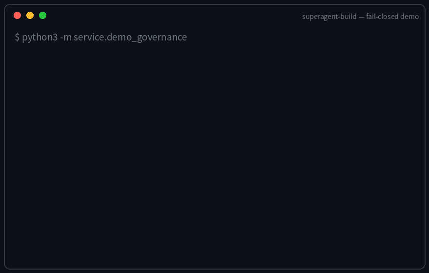
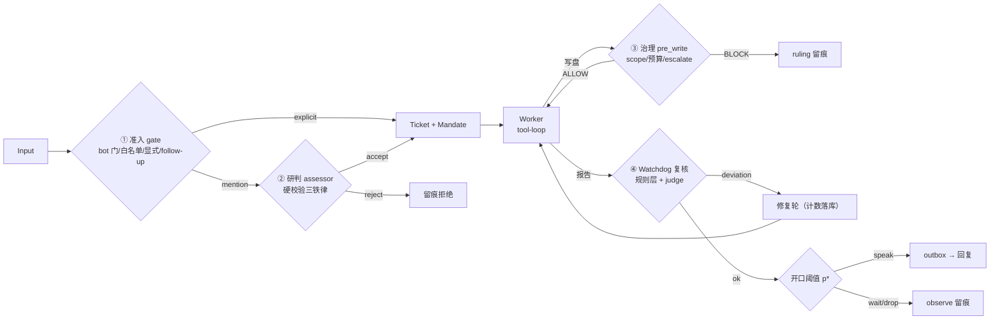

# superagent-build — 自研 Super Agent（治理内嵌 + Watchdog + 主动阈值）

[](https://pypi.org/project/superagent-build/)
[](https://pypi.org/project/superagent-build/)
[](LICENSE)
  


**这是什么**：一个把治理当第一公民的多 agent 内核——每条输入先过两级准入，
每个写盘先过作用域闸（未授权即 BLOCK，fail-closed），每份报告先过 watchdog
复核，每次"要不要打扰用户"过开口阈值。全部判决落 append-only 留痕，可审计。
纯标准库，零依赖。



<details><summary>上面 GIF 的每一行都从真实引擎事件流重算（点开看证据）</summary>

`docs/demo_events.jsonl` 是这次演示的真实事件（Echo 语义执行器，零网络零模型
调用，治理/watchdog/复审环/主动层走的都是生产代码路径）。重新生成：
`python3 service/make_demo_gif.py`。

</details>

## 架构（两 agent 循环 + 四道闸）



四道闸全部 fail-closed：②缺研判层拒、③未声明 scope 拒（修复计数落库防恢复
清零）、④复核不过给一轮修复再不过终票、判决 reason 出词表直接 ValueError。

> 定位：把 dsh-superagent-prototype（22k★）宣传了但没做的四件事真的做出来。
> 证据链：拆解报告见 [aidless/superagent-dig](https://github.com/aidless/superagent-dig)
> `01-prototype-dissection.md`（文章卖点兑现度表）。

## 与原型的差异（本项目核心增量）

| 能力 | 原型 | 本项目 |
|---|---|---|
| 跑偏检测 | 全库零实现 | `agent/watchdog.py`：Mandate 对照 + 确定性规则层 + judge 一票否决 |
| 文件级冲突 | 只在 PR 层暴露 | `agent/governance.py`：写前 claim/check，未声明即 BLOCK |
| 长期记忆 | 只写不读半成品 | `agent/store.py` 全量落库 + 判定留痕（ruling/watchdog 记录可审计） |
| 主动性开口 | 无 | `agent/proactivity.py`：p*(t) 临界确证度 + observe 模式攒标注 |

抄原型的（已验证扎实）：两级准入、先存后做 outbox 三角、纯幂等 receipt、follow-up 语义、
bot 门、"Router 少说话"。

## 运行自检（RED→GREEN 纪律：先注入违规证明会红，再验证放行）

```bash
python3 -m pytest tests/ -q             # 101 passed：i1_i4/i2/i3/i5/i6/integration + j1/j2/j3/j4 + k3 + v03_upgrades + v031_repairs_persist + 老套件
python3 tests/test_store.py            # 老套件为自检脚本，逐个跑，末行 FAILURES: none 即过
python3 tests/test_admission_outbox.py # 持久层：先存后做/幂等/退避/崩溃恢复
python3 tests/test_e2e_m0.py           # 端到端：建票→派工→报告→回复→恢复
python3 tests/test_governance.py       # 写作用域治理（M1）
python3 tests/test_watchdog.py         # 跑偏检测（M2）
python3 tests/test_proactivity.py      # 开口阈值（M3）
```

## Assessor A/B eval (30 tasks, real gateway)

ground truth 标签的任务集（6 explicit 合规 + 15 mention 合规 + 9 mention 诱饵），
两臂对照：A=LLMAssessor（deepseek-v4.1-flash 研判），B=assessor=None（fail-closed）。

| 指标 | A 臂（assessor） | B 臂（fail-closed） |
|---|---|---|
| admission precision | 1.0 | 1.0 |
| recall（合规任务收下率） | **0.571** | 0.286 |
| mention 路由召回 | **6/15** | **0/15** |
| 诱饵误收（危害面） | **0** | 0 |
| worker 调用 / tokens | 25 / 9295 | 12 / 4495 |

结论：**研判层在 mention 路由上把召回从 0 提到 40%，诱饵误收为 0**——
它买到的是"fail-closed 基线永远接不了的非显式任务"，且没引入新的危害面。
诚实口径：assessor 自身的 ~24 次调用未入 worker 台账（已知计量缺口，其成本
未计入上表）；mention 召回 40% 说明研判 prompt 仍偏保守，有上调空间。
产物：`results/eval/assessor_ab/report.json`（report/armA/armB/metrics 全落盘）。

## 里程碑状态

- [x] M0 骨架：准入/outbox/ticket/编排，端到端绿（test_e2e_m0）
- [x] M1 治理内嵌：governance.py 接进 engine.pre_write + intake 携带 mandate_rules（test_e2e_m1）
- [x] M2 Watchdog：接进 engine.on_worker_report（deviation → 判决留痕 + 票终止 + 不回复）（test_e2e_m2）
- [x] M3 主动性：接进 engine（observe 模式先行，判定留痕含 p*/u_eff/confidence 三数）（test_e2e_m3）
- [x] I1 状态回灌：崩溃恢复补上另一半——Tickets/Thread（含订阅）从 SQLite 重载 + seq 防撞号；
      重启后同线程 follow_up 仍附加原票（test_i1_i4）
- [x] I2 研判接真：assessor.py——LLMAssessor（OpenAI 兼容端点，transport 可注入）+
      有界研判上下文（前5条+trigger+后5条，4000 字符封顶）；解析失败/幻觉规则名一律 fail-closed（test_i2_assessor）
- [x] I3 真执行器：openai_executor.py——OpenAI 兼容 tool-loop worker + metrics.py 成本记账
      （逐调用 CallRecord：tokens/延迟/成功率，JSONL 落盘）；对接位 = Magpie 网关（test_i3_executor）
- [x] I4 复审环：deviation 不再一票终止——先给一轮修复机会（违规理由作为修复指令重投 worker，
      复核转绿则照常回复），次数用尽才终止 + 落 governance ruling；max_repairs=0 保持 M2 旧契约（test_i1_i4）
- [x] I5 校准机制：calibration.py——ConfidenceEstimator（证据源合成，已接进 engine 替换硬编码 0.95）+
      LabelStore（observe 判定旁路自动攒标注）+ calibrate（网格搜索开口 precision≥0.8）（test_i5_calibration）
- [x] I6 调度循环：scheduler.py——tick 驱动（max_workers 槽位/idle 超时回收/出站 pump），
      engine 交付后写 idle_at；无 sleep 无线程，clock 注入可测（test_i6_scheduler）
- [x] M4 成本对接：sweep_bridge.py——MetricsLedger ↔ `../superagent-dig/02-cost-experiment/framework.py`
      双向桥（ledger→RunRecord 映射 + router 税记账），盈亏数学（breakeven_price/
      breakeven_attention/paired_bootstrap_ci/verdict）直接调任务②原函数（单一事实源）；
      EchoExecutor 确定性双臂 sweep 出 p*/C*/三档判决曲线点（test_j4_sweep_bridge）
- [x] J1 LLM judge：watchdog.py 加 LLMJudge（三值判决严格 JSON，幻觉判词/网络失败/解析失败
      一律 UNASSESSABLE fail-closed，有界证据 4000 字符，judge 调用入成本账 kind="judge"）（test_j1_llm_judge）
- [x] J2 真执行器：executing_executor.py——治理在执行路径内强制（write_file/append_file
      必过 write_gate，BLOCK 不落盘且回填 BLOCK 事实给 worker；治理挂点缺位 fail-closed
      拒一切写）；真写走 host_exec 可注入（test_j2_executing_executor）
- [x] J3 校准闭环：calibration_loop.py——observe 攒事件 → 启发式/人工标注入 LabelStore →
      calibrate 出参数 → apply_calibration 达标才回写 ProactivityConfig 并解除 observe
      （不达标绝不动参数）；labels.jsonl append-only 可复读（test_j3_calibration_loop）
- [x] K1 真实臂 sweep：sweep_bridge.py 加 run_real_sweep——single 臂（裸 worker 无治理）vs
      dual 臂（Engine 全链）真跑 Magpie 网关（deepseek-v4.1-flash），2任务×2seeds×2臂=8 runs
      真实 usage；delta_tokens=1654 vs 介入节省 4 次 → p*=0.0121 元/token、verdict=DUAL_WINS
      （results/real/sweep_curve.json，诚实口径：介入价值 V=5.0 为假设参数；
      8 runs 只是探路 batch —— 结论级验证见下方 v0.3.2 的 32-run，且它**推翻了**
      这里的 token 符号结论）
- [x] K2 真标注数据：12 真任务（合规/挑逗/闲聊）独立线程真跑，observe 攒 12 事件 →
      close_loop 真校准 applied_params=(0.5,0.2,0.05)（precision 1.0 n_speak=3 trusted）；
      诚实发现：confidence 同质化（单一证据源+watchdog 全 ok → 12 事件同置信度），
      当前为方向性验证，非充分统计
- [x] K3 择优修复（I5 缺口 C2）：calibration_best.py——calibrate_best 显式择优替代
      "网格第一组"：样本量门（n_speak≥3 才 trusted，防 n_speak=1 撑不起 precision）+
      (precision, n_speak, 保守度) 降序择优 + alternatives 全达标组审计（test_k3_calibration_best）
- [x] v0.3.0 六条生态升级（源自 06-ecosystem-learning 四项目拆解，全部 RED→GREEN，
      test_v03_upgrades 13 条）：
      ① escalate 档——governance.py request_escalation + check(content_hash=)
        一次性 lift（审批绑定内容哈希，AGT 式"可解除 BLOCK"）；
      ② 预算进治理——intake(budget_tokens=) 票级 token 上限，超限 BUDGET_EXCEEDED
        终票（成本账从事后度量升级为事中硬闸，AGT budgets.rego 思路）；
      ③ 派发租约——Scheduler pre_deliver_check 钩子，派发/idle 回收前查票状态
        （sessionguard 式写前重读，消派发与用户消息竞态）；
      ④ APx 式信用门——speak_bad>0 的批次官方校准 INELIGIBLE（只给诊断值）；
      ⑤ reason 词表——engine.REASONS 判决原因统一，词表外直接 ValueError
        （v0.3.0 七种 → v0.3.2 八种，新增 failed_same_sha_retry_limit）；
      ⑥ symlink 加固——O_NOFOLLOW 打开 + governance normpath 拦 lexical 穿越。
- [x] v0.3.1 修复：复审环修复计数落库（engine.py _repairs 内存 dict → store kv
      "repairs:{tid}" 唯一事实源）——崩溃恢复后 max_repairs 不再形同虚设
      （test_v031_repairs_persist，RED：恢复后第二份 deviation 必走 repair-limit）；
      service/eval_assessor_ab.py 研判层 30 任务 A/B 对照（见上表）
- [x] 服役批（service/run_service.py）：真网关真杂活 3 任务（CHANGELOG 维护/
      越界挑逗/运行日志）全链跑通——worker 经治理路径真写盘、越界请求自主拒绝、
      T2 报告诚实标注"已提交、结果未确认"与盘上事实吻合；
      文本工具协议兼容（<tool_call> JSON 与 DSML invoke 双格式解析）。

## v0.3.2：方向性证据 → 结论，治理契约 → 机器可读规范，校准闭环回写

> 版本口径：本节工作即 **0.3.2**（PyPI `superagent-build==0.3.2`）。发布稿见
> `docs/RELEASE_CN.md` / `docs/RELEASE_EN.md`。

### 32-run 真跑推翻了 8-run 的符号结论

`service/run_sweep_b.py`：4 任务 × 4 seeds × 2 臂 = 32 runs，真网关
`deepseek-v4.1-flash`，usage 逐调用取真实值（`results/real/sweep_b/runs.jsonl`）。

| 指标 | 8-run（K1 探路） | 32-run（v0.3.2） |
|---|---|---|
| Δtokens（dual − single） | +1654 | **−628** |
| 每对均值 Δtokens | — | **−39.25**（噪声量级） |
| 同批内逐 seed 符号翻转 | 未测 | **是**（`sign_flips_within_batch=true`） |
| 配对 bootstrap 95% CI | 未算 | **[−8.3339, −8.3329]，不跨 0** |
| p*（ΔN·V/ΔT） | 0.0121 元/token | **null**（ΔT<0 侧平衡点不存在） |

结论修正：治理链**不引入可测 token 税**，但同样**不能**宣称"双层省 token"——
符号在 seed 之间随机翻转，−628 是 16 对里凑出来的净值。判决 `DUAL_WINS` 由介入
计数假设（single=2 / dual=1）单边驱动；V 从 0.001 扫到 20 全是 DUAL_WINS，恰好
说明它测的是固定的介入计数差，不是成本结构。**成本账在本仓只作假设压力测试，
不作"省了多少钱"的证据。**

证据包：`evidence/`（10 个只读副本 + `MANIFEST.sha256` + `REPRODUCE.md`），
`service/make_evidence_bundle.py --verify` 可复算，CI 里有一步跑它；篡改任一字节
即 `ok:false`（自测覆盖）。

### 治理契约机器可读化

- `docs/spec/GOVERNANCE.md`：RFC2119 关键词 + 8 个干预点覆盖表（**5 处诚实标留白**）+
  判决闭合集 `ALLOW/BLOCK/ESCALATE`（ESCALATE 是 ruling 流第三态 + 一次性 lift 绑
  `content_hash`）+ **M1..M29 每条 MUST 配一个 conformance 测试**
  （`tests/test_conformance.py` 23 条 + `tests/test_v033_section8.py` 7 条 = 30 条，
  每条内部 RED→GREEN）+ S1..S8 SHOULD 偏差表。
- **§8 差异七处实修**（M23..M29，全部带行号锚点写进规范）：无 metrics 时预算闸
  `fail-closed 拒收`（`engine.py:95`）· escalate lift 经内容哈希在写路径真被消费
  （`executing_executor.py:187` `_gate_allows` 三参分流）· `Watchdog` 无判据构造直接
  `ValueError`（`watchdog.py:242`）· outbox 非通道异常改为退避重试不留死信
  （`outbox.py:46`）· `Scheduler` idle 回收落 `IDLE_TIMEOUT` 判决（`scheduler.py:121`）·
  `accept_on_broadcast` 校验分支可达（`admission.py:84`）· `scopes.json` 旧态快照 + 原子
  替换（`governance.py:105`）。
- `docs/adr/ADR-0001-fail-closed.md`：fail-closed 不许做成配置开关。落地时收口了一条
  真偏差——`pre_write()` 在治理挂点缺位时曾 `return True`，现为 BLOCK + 判决留痕
  （M22 守住）。

### 先修再攒 K2（estimator 扩维 + 输入侧候选 + 复审熔断）

- **Estimator 六维证据**：watchdog verdict / has_explicit_marker / is_bot /
  text_len 分档 / tool_rounds / repairs；空证据仍 0.4，旧单源口径逐字不变
  （`test_v04_estimator.py`）。
- **输入侧候选**：被拒/闲聊输入造低效用候选写 `observe_log`（8 字段与完成侧一致），
  不写回复、不改 disposition（`test_v04_input_events.py`）。
- **复审熔断**：连续 watchdog 非 OK 计数落 store kv `review_fail:{tid}`，OK 清零，
  超上限（默认 3，对齐 agent-orchestrator `autoReviewFailedRetryLimit=3`）即熔断并落
  `reason: failed_same_sha_retry_limit`（`test_v04_review_fuse.py`）。
- **assessor 调用入台账**：成功记真实 usage，失败记 `ok=False` 零 token——失败次数
  可观测，且不污染 token 成本（`test_v04_assessor_ledger.py`）。
- **真跑 10 任务批**（`service/run_daily_batch.py`）：observe 事件从"全同质 conf=0.533"
  变成 0.480 / 0.510 / 0.533 三档；真校准结果
  `speak_ok=9 / wait_ok=3 / wait_bad=1` → `calibrated=True`，
  `applied_params=(c_false=2.0, c_speak=0.5, lam=0.05)`——比早期
  `(0.5, 0.2, 0.05)` 更保守，是 K3 择优键（精度优先→同精度开口更多→更保守参数）
  在真数据上的体现（`results/real/d4_calibration/calibration.json`）。
  诚实口径：13 条事件、启发式标注 + 1 条人工覆写（"紧急求助被静默"记 wait_bad），
  是方向性验证，不是双人独立标注的充分统计。

### 校准闭环：从"只出报告"到"真回写服役"

v0.3.2 之前 `close_loop()` 只输出 `applied_params`，参数从不回写到运行中的
`ProactivityConfig`——报告是一回事，服役是另一回事。这一版把链路接通：

- `calibration_loop.close_loop(..., cfg=..., apply=True)`：达标才调
  `apply_calibration()` 写回 `c_false/c_speak/lam` 并**解除 `observe`**；不达标返回
  `applied=False` 且参数逐字不变（`test_p1a_calibration_apply.py` 8 条）。
- `calibration_loop.load_calibrated_cfg(report)`：从**已落盘**的校准报告建配置；
  报告里 `calibrated` 不为真或三键不全 → 回落默认 `observe=True`（fail-closed）。
- 完成侧多维证据：`Engine(completion_evidence=build_completion_evidence)` 注入后，
  开口置信度由 watchdog 判决 / 显式标记 / bot 标记 / 文本长度分档 / 工具调用轮数 /
  修复次数六维合成；**不注入时逐字保持旧单键口径**（`test_integration.py:52` 仍精确
  断言 `estimate({"watchdog_pass": 1.0})`）。
- 解除 `observe` 后的开口不再只写日志：落 `notices(effect=proactive_speak)` + store kv
  `proactive:{event_id}`，可被上层消费。

三臂真跑（Magpie `workbuddy/deepseek-v4.1-flash`，usage 逐调用真实，汇总落
`results/real/p1b/summary.json`）：

| 臂 | 配置 | calls | tokens | observe 事件 | 开口 | 置信度档位 |
|---|---|---|---|---|---|---|
| 1 同构 10 任务 | observe + 多维证据 | 7 | 3700 | 10 | 0 | 0.48 / 0.51 / 0.6133 / 0.6267 |
| 2 异构 6 任务 | observe + 多维证据 | 6 | 5896 | 6 | 0 | 同上（完成侧两档） |
| 3 同异构 6 任务 | 校准回写 → observe=False | 6 | 4225 | **0** | **4** | 0.6133 ×2 / 0.6267 ×2 |

口径声明：臂 3 的 4 条开口无人复核，本批证明的是**链路跑通**（回写→解除→开口留痕），
不是开口精度；`p*=(c_false+c_speak)/(10+c_false)=0.208333`（沿用 d4 的 13 条单键
事件参数），换多维证据后应重跑校准再放行。同构批也出现两档，是因为工具调用轮数不同；
档位区分度真实但窄。

### 分发与面试转化

- **PyPI 0.3.1 已上线**（此前 README 说 0.3.x 而 PyPI 只有 0.1.0——对外口径断裂已修）。
- `issues/1`：上游五卖点兑现度核对表归档（上游仓 `has_issues=false`，无法直接提交）。
- `docs/RELEASE_CN.md` / `docs/RELEASE_EN.md`（中英发布稿）+
  `docs/INTERVIEW.md`（20 问，123 处 `file:line` 引用全部现场验过）。

## 溯源：先拆解，后自研

本项目的分析底稿与架构依据来自对 [dsh-superagent-prototype](https://github.com/deepseek-ai/dsh-superagent-prototype) 的逐文件拆解（五卖点兑现度表、可靠性底座分析、成本模型），全文见姊妹仓库 [aidless/superagent-dig](https://github.com/aidless/superagent-dig)。

## 与同类项目的定位对比（2026-11-10，GitHub 星数为当日快照）

| 项目 | ★ | 定位 | 与本项目的差异 |
|---|---|---|---|
| [deepseek-ai/dsh-superagent-prototype](https://github.com/deepseek-ai/dsh-superagent-prototype) | 22.0k | 双层异步原型（宣传稿） | 本项目把其"宣传了但没做"的四件事（watchdog/文件级治理/主动阈值/调度）做出来并测出来 |
| [chunonesoft/open-superagent](https://github.com/chunonesoft/open-superagent) | 5 | 同原型的主动式编程智能体（GitLab/钉钉） | 走通道集成路线；本项目走"可测内核+治理确定性证据"路线 |
| [ruijh/dsh-superagent-prototype-analysis](https://github.com/ruijh/dsh-superagent-prototype-analysis) | 3 | 原型 49 图可视化分析 | 只分析不实现；本项目=分析+自研实现+真网关验证 |
| [openai/openai-agents-python](https://github.com/openai/openai-agents-python) | 30.6k | 多代理工作流框架 | 通用编排无治理确定性；本项目每层有 fail-closed 铁律与 RED→GREEN 证明 |
| [MetaGPT](https://github.com/FoundationAgents/MetaGPT) | 71.2k | SOP 多代理软件公司 | 重角色分工轻可靠性底座；本项目重 outbox 三角/崩溃恢复/成本全口径账 |
| [litellm](https://github.com/BerriAI/litellm) | 63.0k | LLM 网关+guardrails | 治理在网关层按请求拦截；本项目治理在**任务语义层**（Mandate 边界+写前裁决+跑偏复核） |

**生态位**：不是又一个编排框架——是"把 Super Agent 原型欠下的可靠性账补齐"的可测内核：
两级准入防幻觉铁律、先存后做投递、写作用域确定性拦截、跑偏复审环、开口阈值+校准、逐调用成本账（worker+assessor 全口径）。

## 真网关点火记录（2026-11-10，Magpie `deepseek-v4.1-flash`）

`python3 demo_real.py` 端到端真跑（零注入 transport，全部真实 HTTP）：

- **合规路径**：`/task` 显式准入 → 真 assessor/worker LLM 调用 → worker 报告
  touched_paths → 治理 `pre_write` ALLOW → watchdog OK → observe_speak
  （estimator conf=0.533，p*=0.1091）→ 回复出站 → `/tmp/superagent-demo/notes.md` 真落盘。
- **挑逗跑偏**：mandate 禁改 README.md + 输入故意要求顺带改 → 治理确定性 BLOCK
  （ruling 落盘），worker 如实上报未越界；越权写被治理层硬拦。
- **真模型幻觉被铁律拦截**：assessor 研判曾答 `broadcast`（不在候选规则列表）→
  `rejected_eval:hallucinated_rule` fail-closed 拒单，三铁律在真实模型上生效。
- **成本记账**：2 次 worker 调用 2375 tokens（prompt 539 + completion 1836），
  成功率 100%（`results/real/metrics.jsonl`）；observe 旁路
  `results/real/observe_log.jsonl`。
- follow_up 线程连续性语义在同线程第二消息上实测生效。

## 真实环境对接位（本仓库只含可测内核）

- `openai_executor.py` 的 `OpenAICompatExecutor`：已实现 OpenAI 兼容 tool-loop worker（默认指向
  Magpie 网关 `http://127.0.0.1:3425`），transport 可注入；换 endpoint/model 即换 worker；
- `assessor.py` 的 `LLMAssessor`：已实现研判适配器（有界上下文 + fail-closed），接进 `Engine(assessor=...)` 即生效；
- `watchdog.py` 的 `Judge` Protocol：接独立 LLM judge（语义层"答非所问"检测）；
- `outbox.py` 的 `Deliverer`：接 GitHub/飞书通道（channelGone/channelIgnored 唯二合法放弃）；
- `scheduler.py` 的 `Scheduler.tick`：外部主循环每轮调一次即可驱动全系统（无 sleep 无线程）；
- `metrics.py` 的 `MetricsLedger`：逐调用成本记账（tokens/延迟/成功率，JSONL 落盘），
  与 `../superagent-dig/02-cost-experiment/framework.py` 的 CallRecord 同构对接。
